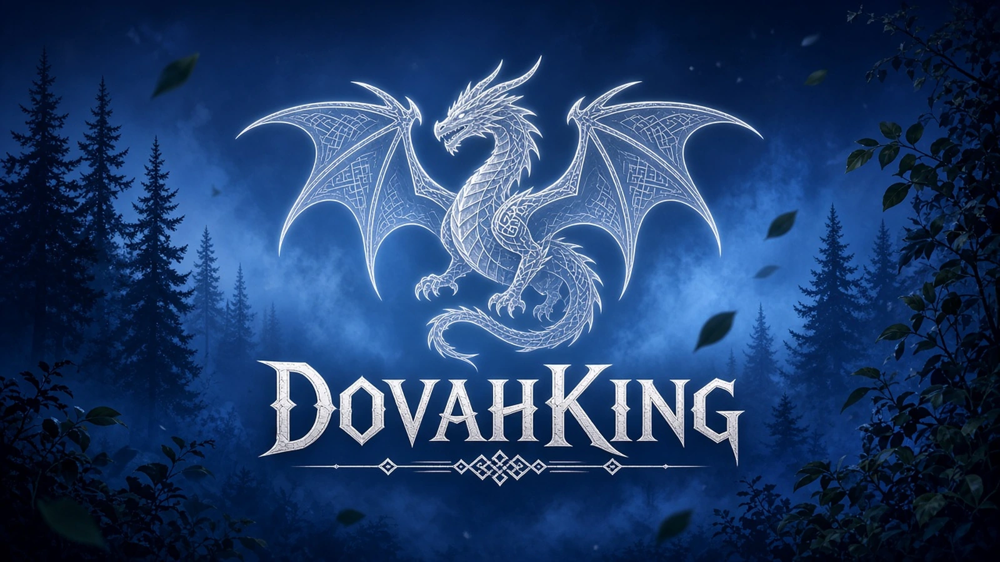

  

<h1 align="center">DovahKing</h1>

<b>A warm, lived-in Skyrim, 800+ mods, one click with Wabbajack.</b>

  
  
  
  
  

---

## ✨ What is DovahKing?

DovahKing is a Skyrim Special Edition modlist by **FluffyTheDemon** that keeps the Skyrim you love and makes it richer. It has warm, natural Tabula Rasa visuals, hundreds of new armors and weapons, livelier cities and dialogue, and combat that's fun and fair without being punishing. It's fully set up for controller, with profiles from 1080p all the way to ultrawide.

## 📋 Requirements

- **Skyrim Special Edition** on Steam, version **1.6.1170**, with the **Anniversary Edition** content
- A **Nexus Mods** account (Premium makes downloads automatic; free works with manual clicks)
- [Wabbajack](https://www.wabbajack.org/)
- Lots of free disk space. LOD, grass cache and textures are big, so an SSD is strongly recommended.
- A clean, unmodded Steam install. DovahKing uses its own **Stock Game** folder, so your Steam files stay untouched.

## 🧰 Before you install

Most SKSE plugins need Microsoft's C++ runtimes, so grab these first:

- [Visual C++ Redistributable 2015–2022 (x64)](https://aka.ms/vs/17/release/vc_redist.x64.exe)
- [Visual C++ Redistributable 2015–2022 (x86)](https://aka.ms/vs/17/release/vc_redist.x86.exe)

Also recommended:

- Launch Skyrim once from Steam so it creates its settings files, then close it.
- Add your DovahKing install and downloads folders to your antivirus exclusions. Windows Defender can slow down or block Wabbajack.
- Set your Windows page file to at least **20 GB**, or leave it on "System managed". Large lists need it to avoid crashes.

## 🛠️ Installation

1. Download and run [Wabbajack](https://www.wabbajack.org/).
2. Download `DovahKing.wabbajack` (link on the Discord) and open it in Wabbajack with **Install from disk**.
3. Pick an install folder (for example `C:\DovahKing`) and a downloads folder. Avoid Program Files and the desktop.
4. Click **Install**. When Wabbajack pauses for **Modern Stagger Lock**, download `Modern.Stagger.Lock-v1.07a.-.AE.-.VR.7z` from the GitHub page it opens, and it'll carry on.
5. Open `ModOrganizer.exe` in your install folder, pick your profile, and launch **SKSE**.

## 🖥️ Profiles

| Profile | Resolution | Mode |
|---|---|---|
| 01 / 02 | 1920×1080 | Quality / Performance |
| 03 / 04 | 2560×1440 | Quality / Performance |
| 05 / 06 | 3840×2160 (4K) | Quality / Performance |
| 07 / 08 | 2560×1080 ultrawide | Quality / Performance |
| 09 / 10 | 3440×1440 ultrawide | Quality / Performance |

**Performance** profiles use VRAMr-optimized textures and lighter settings. **Quality** profiles use full-resolution textures.

## 🎨 Highlights

- **Visuals:** Community Shaders with a warmer, slightly brighter Tabula Rasa preset, plus pre-built terrain, object and tree LOD and a grass cache
- **Gear:** hundreds of new armors and weapons that fit the world
- **World:** richer cities, interiors, clutter and lighting
- **Combat:** fun and responsive, without being punishing
- **Controller:** Wheeler radial menu on the left bumper with a Nordic-style skin

## 🎮 First launch

- MCM settings come preconfigured. On a **new game**, **MCM Recorder** plays the *Author's Choice* recording about 30 seconds after character creation. Let it finish before opening menus.
- Menus don't pause the game (Skyrim Souls RE). That's intentional.
- Always launch **SKSE** from MO2, never from Steam.

## ⚠️ Please don't

- Run LOOT or change the load order. It's hand-tuned.
- Update Skyrim past 1.6.1170.
- Remove the `DovahKing - ` patch mods. They hold the list's custom fixes.

## 💬 Support

Questions, bugs or screenshots? Come say hi on **[Discord](https://discord.gg/X7WnTVTSHM)**.

## ❤️ Credits

DovahKing would be nothing without the incredible mod authors of the Skyrim community. All mods belong to their creators, so please endorse the ones you enjoy on Nexus Mods.
